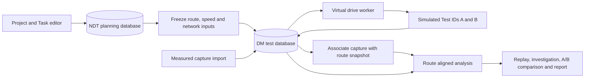

# NDT and DM Integration Plan for Virtual Drive Tests and Parameter A/B Comparison

Status: Initial integration implemented, 12 November 2026. The delivery ledger below identifies the implemented scope; remaining design sections retain the staged target architecture.

| Phase | Current delivery |
| --- | --- |
| Shared route foundation | Context hashes, frozen route/network inputs, original-geometry retention and versioned single-pass capture association are implemented. Independent road-fit accuracy qualification, multiple execution legs and repeated-lap matching remain future work. |
| Integrated DM workspace | Same-origin workspace/API, Task and Project navigation, existing-registry adoption, profiles, replay, investigations and exports are implemented. |
| Virtual drive execution | One durable local worker, bounded/idempotent jobs, constant-speed trajectory generation and isotropic UMa planning power are implemented for one selected route per run. |
| Parameter A/B | Power changes, paired speed-case matrices, spatially aligned comparisons, difference-map inspection and reproducible manifests are implemented. Imported comparisons remain observational. |
| RF and mobility expansion | Antenna patterns/tilt, reference-signal normalization, interference, mobility procedures and service models remain unimplemented. |

The implemented baseline is documented in `FEATURE_DESCRIPTION.typ`, `SOFTWARE_DESIGN.typ` and the 167-entry feature inventory. Their descriptions take precedence over future capabilities in this plan.

Integrate DM as a drive-test workspace within Toronto NDT. NDT owns saved Projects, Tasks, routes and network inputs; DM owns captures, replay, investigation and comparison. Both measured and simulated tests must reference an immutable snapshot of the selected Task route. Parameter A/B experiments run against that same snapshot and record exactly which parameters changed.

The initial Parameter A/B scope assumes radio configuration changes while route, speed and evaluation criteria remain fixed. Speed comparisons use the existing Task speed cases as a separate experiment dimension. The design also permits later UE and traffic comparisons when the simulation model supports them.

## 1. Original implementation and integration gaps

| Area | Current implementation | Integration required |
| --- | --- | --- |
| Planning | NDT persists Tasks, ordered routes, path/guide coordinates and multiple speed cases in `regions.sqlite3`. | Publish versioned route and execution-context contracts. |
| DM planning link | DM reads NDT region/project metadata and Task IDs/names through a read-only SQLite adapter. | Supply route geometry, route identity, speed cases and network snapshots. |
| Drive-test records | DM keeps immutable normalized captures, source hashes and Test IDs in its own SQLite registry. | Add simulation provenance, route associations and immutable experiment manifests. |
| Analysis | DM provides replay, thresholds, empirical CDFs, sample exploration, issues and reports. Its baseline candidates share region/project/task and source kind. | Compare observations at corresponding positions on an approved route and retain the comparison basis. |
| Radio calculation | NDT supplies a fixed-height UMa path-loss and coverage-radius preview. Sector fans are display geometry, drawn at a reduced radius by default. | Add a sample-producing simulation engine with explicit supported parameters and metric definitions. |
| Project use cases | Virtual Drive Test and Parameter A/B Test are saved project categories. | Connect those categories to executable workflows. |

Authoritative source locations appear in section 10. The present baseline comparison is descriptive and does not establish route equivalence or a parameter effect.

## 2. Application and ownership boundaries

Use the existing local Python and browser-module stack. Serve the DM workspace at `/drive-test/` and its endpoints under `/api/dm/` from the NDT server. Preserve the DM MVVM separation and reuse its replay, investigation and report components. Namespace its asset URLs and API paths; its present root-relative URLs would otherwise collide with NDT. Load one vendored MapLibre version per page. Resolve basemap/snapshot assets and map extent from the selected NDT region and route; DM's current downtown Toronto snapshot cannot serve as the default context for every region.

Bring the required DM modules into the repository as an owned component with their source revision recorded. The integrated application must run from a fresh checkout without importing code from `/Users/parkjangwon/Documents/ChatGPT/dm`. Keep the standalone DM application available during migration, with one authoritative implementation of each imported component.

| Owner | Persistent responsibility |
| --- | --- |
| NDT planning store | Current Project/Task definitions, editable routes, speed cases, project site selections and static Virtual UE configuration. |
| DM test store | Existing Test IDs, captures, profiles, issues/history, frozen execution inputs, route matches, simulation jobs and comparison manifests. |
| Simulation worker | Calculate observations from frozen inputs and publish complete run results through the DM store. |
| Browser ViewModels | Selection, drafts, replay state and progress; persisted input values are accepted server records. |

Retain the two databases initially. Use explicit database paths and preserve DM's existing registry-location precedence during adoption. The server reads a consistent planning snapshot and copies it into the test store; execution then needs no live planning reads. No transaction spans both databases.

Do not place cascading foreign keys from test history to editable Task rows. NDT currently replaces the project's Task graph on save. A later save, rename or deletion must leave historical test inputs and results intact. New DM routes retain its existing loopback Host, same-origin and bounded-request checks.

## 3. One route contract for planning and test data

Identify a live route by `(region_id, project_id, task_id, route_id)`. At launch or capture association, freeze its ordered WGS84 `[longitude, latitude]` geometry and execution context. Assign an immutable `route_snapshot_id`, an ordered-geometry hash and a schema version. Keep the originating IDs and display names as provenance.

The snapshot records path coordinates, original input geometry when available, guide coordinates, fitting status, route length, direction, selected speed-case values and the distance calculation version. New fitting operations must retain their complete original input. Already fitted legacy routes whose original input was discarded carry an explicit unavailable-original marker.

Use one geodesic convention for newly generated route lengths, chainage and timestamps; chainage means distance along the route. Preserve DM's existing raw GPS-distance statistic under its current definition. Do not silently recalculate historical capture statistics when adopting the shared convention.

Rules for every workflow:

- A simulation starts from a saved Task route. Launch verifies the expected saved-context hash; a changed context returns a conflict and requests a refreshed selection. Unsaved drafts stay in the editor.
- A Task with several routes has explicit ordered legs. Select individual legs or define their execution order. Disconnected legs have a segment break or an explicit transfer; no artificial connecting drive segment contributes distance or coverage.
- Preserve the raw measured GPS trace. Store route associations separately, with route snapshot, sample identity, leg/pass, direction, chainage, lateral error and match status. Missing GPS and ambiguous matches remain visible.
- Detect heading and continuity as well as distance when matching. Intersections, parallel roads, loops, repeated passes and reverse drives must not collapse onto the nearest coordinate alone. Reject an association when the captured extent does not fit the chosen route.
- A capture may remain unassociated for ordinary DM analysis. It becomes eligible for route-based comparison after a route association passes the experiment's saved matching criteria.
- Show planned geometry, observed trace and simulated trajectory as distinguishable layers. Use geographic coordinates for analysis; screen pixels and sector display fans are never simulation inputs.

Strengthen road-fit validation before describing a route as verified. The current routing adapter validates returned coordinates but does not evaluate returned waypoint offsets or deviation from route intent. Preserve the original geometry, validate endpoint/guide offsets and path deviation, and retain the result of those checks. A planning fit and a measured-trace association are different operations. Existing `roadFit: fitted` values remain legacy fit status until evaluated under the new checks.

Matching tolerances, minimum matched coverage and maximum allowed gaps belong to a versioned project policy. Initial values must be qualified on representative traces; they are not operator acceptance standards. Exploratory simulations may use explicitly provisional geometry, with that condition retained in their results.

## 4. Execution and observation contracts

The execution manifest freezes the route snapshot, speed-case ID and value, ordered legs, UE profile, sampling policy, network snapshot, effective parameter set, model/version, assumptions and any random seed. Capture the complete effective parameter configuration as well as the A/B difference. Include all modeled interferers in the frozen network context, even when they fall outside the edited project site list.

The mobile UE follows the selected Task route. An existing static Virtual UE may be referenced as a planning asset, but its saved position does not become a mobile trajectory and replay must not update that position. Device capabilities and any assumed antenna height belong to the execution profile, subject to the engine's supported values.

Parameter sets use stable site/carrier/sector identifiers, units, allowed ranges and capability checks. NDT's bearing groups and aggregated licensing records do not necessarily identify live cells. Preserve those source records and create explicit planning carrier/sector entities where required; do not invent a PCI or live cell identity from an azimuth.

Use DM's existing UTC millisecond `t`, `rat` and latitude/longitude observation conventions. Add a versioned simulation envelope and sample identity instead of passing extra fields through the present CSV parser, which ignores unknown columns. Refactor shared observation validation so imported and generated observations pass equivalent boundary checks, while retaining source-specific rules.

| Persisted addition | Contents |
| --- | --- |
| `execution_snapshots` | Immutable route/network/UE/speed/sampling manifests, versions and hashes. |
| `parameter_sets` | Immutable effective configuration, parent reference and declared changes. |
| `test_contexts` | Test ID to execution snapshot, source origin, model capabilities and parameter-set reference. |
| `route_associations` and sample matches | Capture-to-route matching policy/results and derived sample positions; separate from immutable capture payloads. |
| `experiments` and `experiment_runs` | Experiment type, A/B assignments, selected speed cases, job state and member Test IDs. |
| `comparisons` | Both input Test IDs/hashes, matched domain, parameter difference, evaluation-profile snapshot, algorithm version and summary. |

Keep existing Test IDs and capture payloads intact. Add a distinct `simulated` origin alongside imported captures and synthetic demos, with a transactional migration of the current `tests.kind` constraint and all affected readers, filters and badges. Imported data retains its declared source quality; import alone does not establish that observations are field measurements.

Generate time samples by advancing along each selected leg using the speed case and sampling interval. Preserve exact endpoints, strictly increasing timestamps within a RAT, explicit stops when modeled and breaks between disconnected legs. The selected speed is a simulation input; DM's replay-speed control changes playback only. Record a reproducible time origin for generated runs.

Start with one bounded local worker and a durable SQLite job record. Support queued, running, completed, failed, cancelled and interrupted states, idempotent submission, progress and recovery after restart. Publish each complete Test ID and its result metadata in one transaction. An experiment is comparable only when both required runs have completed; cancellation or partial failure cannot produce a successful A/B result. Enforce observation and storage limits before dispatch; DM's existing per-run limit is 100,000 observations.

## 5. Virtual drive simulation capability

Separate trajectory generation from radio calculation. The worker consumes geographic positions and the frozen scenario, then returns observations plus metric validity and model-limit flags. The renderer consumes those observations.

The first engine can reuse the existing UMa path-loss formulation with numerical parity fixtures against `radio-model.mjs`. Its current fixed heights, LOS/NLOS assumption, frequency domain and 10 m to 5 km distance domain remain explicit. Out-of-domain positions receive an unsupported-result flag, rather than a fabricated measurement.

| Capability | Initial delivery | Expansion condition |
| --- | --- | --- |
| Trajectory and speed | Selected saved route and Task speed case, deterministic sampling and replay. | Add stops and acceleration only with an explicit trajectory model. |
| Power A/B | Per-planning-transmitter power changes and path-loss-based received-power estimates. | Separate total EIRP from reference-signal power and document the conversion before emitting RSRP or SS-RSRP. |
| Azimuth and tilt A/B | Enabled only when the implemented antenna model supplies the required horizontal/vertical response and applicable heights. | Freeze antenna patterns, orientation and gain conventions; validate angle and tilt behavior. |
| SINR and RSRQ | Missing until the necessary interference, noise, bandwidth, loading and signal definitions are implemented. | Use compatible carrier resources and sum interference in linear power. |
| Mobility thresholds | Disabled until a stateful serving-selection/mobility model exists. | Implement filtering, offset, hysteresis, time-to-trigger and explicit event semantics. |
| Throughput and latency | Missing until supported by an explicit service/capacity model. | Freeze bandwidth, scheduling/load, UE capability and traffic assumptions; validate against suitable evidence. |

The initial planning-power metric has its own identifier, such as `predicted_rx_dbm`. Extend DM's metric registry and exports to display it. Do not populate the existing RSRP column with total EIRP minus path loss. A strongest-signal cell transition is a predicted selection event; it does not establish handover success, call continuity or a failure rate.

Separate network parameters from the analysis profile. Changing DM's RSRP threshold changes the evaluation rule; it does not change transmitted power or the generated radio observations. Criteria-sensitivity comparison can evaluate the same immutable run under two profiles, with that experiment type shown explicitly.

## 6. Parameter A/B experiment and comparison

An experiment defines A as the baseline and B as a declared configuration change. For example, A uses one planning transmitter's EIRP and B increases it by 3 dB, while all other frozen inputs remain identical. Use the planning-power metric until the engine supports a valid reference-signal definition.

For radio A/B, hold route snapshot, leg order, direction, speed case, sampling grid, UE, environment/network context, engine version and evaluation profile constant. If the engine is stochastic, pair A/B with common seeds or identical exogenous realizations. Later repeated runs report variation across paired realizations, not confidence based on treating adjacent drive samples as independent trials.

A Task with speed cases of 20, 40 and 60 km/h can produce six Test IDs: A20/B20, A40/B40 and A60/B60. Each radio comparison pairs the same speed; the speed comparison then examines one fixed parameter set across those cases. Preview the resulting run/observation count before dispatch and apply the local capacity limit.

| Comparison mode | Alignment and interpretation |
| --- | --- |
| Simulated A versus simulated B | Exact paired sample positions, times and seeds from one execution specification; quantify the model's predicted parameter effect. |
| Measured A versus measured B | Associate both captures to the same route snapshot, pass and direction; compare their valid common spatial coverage and report differences in device, speed, traffic, time and other known conditions. Unknown configuration yields an observational comparison. |
| Simulation versus measurement | Calibration/validation mode with a common metric definition and matched positions. Report bias and error; do not present it as a controlled network-parameter experiment. |
| Speed-case comparison | Hold the radio configuration fixed and compare by route distance, preserving each case's distinct time grid. Any speed effect on RF or service needs a model that represents it. |

For measured captures, compare common distance bins rather than sample indices or wall-clock timestamps. Freeze bin length, aggregation, direction/pass policy, match tolerances, valid-data rules and the minimum required common coverage. Do not interpolate across GPS gaps or unmatched intervals. Report each run's full-route coverage, the paired coverage and excluded portions so a favorable overlap cannot hide missing route sections.

The comparison result contains A, B and signed `B - A` values per position/bin, metric and RAT. For signal power use dB differences; for failure/coverage percentages use percentage-point differences. Compute received-power means through linear power when claiming a physical average; define other summary operators explicitly. Show distributions, median/lower-tail signal changes, upper-tail latency where supported, covered distance/time, affected route sections and an improvement/regression map. Retain DM's existing sample-weighted statistics under their existing label; new distance-weighted summaries have their own denominators and missing-data coverage.

Use one frozen evaluation profile for both sides of a parameter experiment. Reject mismatched simulation inputs, undeclared parameter differences, unsupported parameter changes, missing required metrics or inadequate common coverage from the controlled-comparison path. Keep the captures accessible for exploratory analysis with the reason shown. A saved comparison retains its exact profile and input hashes even if an analyst edits a run's current DM profile later.

## 7. User workflow and API boundaries

The user selects a Project and Task, then chooses a saved route or ordered legs and a speed case. The workspace shows planned geometry and any associated measured trace, route coverage, source quality and available simulation capabilities. From there the user imports a capture, starts a virtual drive, or creates an A/B experiment by cloning A and editing B's supported parameters.

After execution, the same DM workspace supplies synchronized replay by route distance, KPI charts, A/B difference maps, CDFs, sample investigation and reports. A parameter-difference panel remains available beside the result. Project Overview shows associated Test IDs and experiment status. Navigation back to NDT restores region, Project, Task, route and experiment context; selecting a project use-case category does not itself start execution.

Proposed API responsibilities:

| API | Responsibility |
| --- | --- |
| Existing Task GET plus context revision | Supply current route geometry and speed cases through the planning model. |
| `POST /api/dm/execution-snapshots` | Validate expected context revision and freeze selected planning/network inputs. |
| Existing DM test/profile/issue operations under `/api/dm/` | Preserve capture, investigation and profile behavior. |
| `POST /api/dm/tests/{id}/route-associations` | Produce an immutable version of capture-to-route alignment. |
| `POST /api/dm/experiments` | Freeze A/B or single-run execution specification and submit idempotently. |
| Experiment GET and cancellation operation | Report job/member-run states and retain completed artifacts on interruption. |
| `POST /api/dm/comparisons` | Validate compatibility, freeze the analysis basis and save the result manifest. |

Requests carry explicit scope and references; the server independently validates membership and model capabilities. Manual-ID imports remain available for standalone analysis. The server's planning adapter supplies route/network context to the integrated workspace; the browser does not read either SQLite database.

## 8. Delivery sequence and acceptance gates

| Phase | Deliverable | Acceptance gate |
| --- | --- | --- |
| 1. Shared route foundation | Context hashes/snapshots, original-geometry retention, leg semantics and capture association. | One saved Task route appears with the same ordered geometry in planning and DM; gaps, loops, reverse passes, stale launches and later Task deletion are handled without rewriting history. |
| 2. Integrated DM workspace | Same-origin navigation/API/assets, existing registry adoption, reusable MVVM modules and contextual run lists. | A fresh checkout can import, replay, investigate and export a capture for a selected Task; existing Test IDs, profiles, issues and hashes survive migration and reload. |
| 3. Virtual drive execution | Durable worker, deterministic trajectory, first planning-power model and generated Test IDs. | Identical manifests produce identical normalized observations; timestamps/distance agree with speed and leg definitions; failures publish no partial successful run. |
| 4. Parameter A/B comparison | Immutable parameter variants, paired runs, compatibility checks, aligned metrics and result export. | A versus identical A gives zero paired differences; a controlled power-only case gives the expected local power change; mismatched inputs and inadequate overlap cannot pass the comparison gate. |
| 5. RF and mobility expansion | Antenna patterns, reference-signal metrics, interference, mobility and service models as independently qualified increments. | Each added parameter changes the implemented model as specified, required inputs are enforced and field-validation evidence is retained. |

Within each delivered feature phase, update `outputs/ndt-feature-inventory/feature_inventory.xlsx`, `docs/FEATURE_DESCRIPTION.typ` and `docs/SOFTWARE_DESIGN.typ` together, including applicable registers and counts. The initial integration adds twenty implemented or conditional entries, bringing the registers to 167 features. Future capabilities in this plan remain outside the implemented registers.

## 9. Verification and practical limits

Add contract and numerical fixtures for longitude/latitude order, canonical hashes, units, endpoint preservation, geodesic distance, time sampling, gaps and repeated positions. Exercise legacy registry/schema migration and verify that Task replacement/deletion leaves Test IDs and frozen manifests readable. Check that editing a profile or live network configuration cannot mutate a completed experiment.

Use analytic RF cases for power changes and, when introduced, antenna orientation, co-channel interference and mobility timing. Test model-limit/missing-input states and ensure unsupported metrics remain missing. Route-alignment fixtures cover GPS gaps, parallel roads, intersections, opposite directions, partial overlap and repeated laps. Comparison checks include different sampling rates and denominator/coverage accounting.

Extend the existing Python and JavaScript tests plus Playwright journeys: select Task, import and associate a trace, create virtual A/B, cancel/retry a job, reload results, inspect a changed route position and export a reproducible comparison. Include concurrent launch retries, stale context/profile conflicts, interrupted execution, 100,000-observation runs, keyboard access and responsive layouts. Run project `make check`, the relevant browser suite, both Typst compilations and the workbook/register consistency audit for implementation changes.

Reports and analysis JSON include route/network/parameter hashes, source types, model/version, supported metrics, matching/exclusion coverage, exact evaluation profile and both comparison input identities. Preserve access to both captures; a baseline summary alone is insufficient to reproduce the paired calculation. Keep original imported files under an explicit retention policy because the existing registry stores normalized observations and the original file hash.

The first release supports local planning experiments. Calibration and realistic field acceptance depend on representative captures and reliable radio configuration. New York reservation records lack the radio attributes needed to instantiate the Toronto planning model; enable route/replay workflows there, but require an explicit radio dataset before simulation. Rendered buildings, terrain and visual shadows are not propagation evidence.

## 10. Implementation touchpoints

| Existing source | Change responsibility |
| --- | --- |
| [NDT Task store](../ndt/task_store.py) and [Task API](../ndt/server.py) | Saved-context revisions, snapshot access and safe historical references around whole-project Task replacement. |
| [Task data](../ndt/dist/task-data.mjs), [model](../ndt/dist/task-model.mjs), [ViewModel](../ndt/dist/task-view-model.mjs) and [Overview table](../ndt/dist/task-table-view.mjs) | Original geometry, route/context selection, launch actions and accepted save state. |
| [Road routing](../ndt/road_routing.py) | Fit-quality metadata and validation; retain original geometry in the calling workflow. |
| [Radio model](../ndt/dist/radio-model.mjs) and [sector geometry](../ndt/dist/network-symbols.mjs) | Numerical parity inputs and display/model separation; add backend simulation modules with explicit capability contracts. |
| [Project model](../ndt/dist/project-model.mjs) and [project ViewModel](../ndt/dist/project-view-model.mjs) | Snapshot accepted site selection and project context; retain static Virtual UE ownership in the planning store. |
| [DM server](../ndt/dm/http.py) | Replace catalog-only coupling with the planning adapter; extract reusable API handling and namespace integrated endpoints. |
| [DM storage](../ndt/dm/dm_model.py) | Add transactional migrations, generated-observation validation, provenance, manifests and durable jobs without changing imported capture contents. |
| [DM analytics](../ndt/dist/drive-test/test-model.mjs) and [workspace ViewModel](../ndt/dist/drive-test/test-view-model.mjs) | Capability-aware metrics, explicit comparison modes, route alignment and saved experiment state. |
| [DM data access](../ndt/dist/drive-test/test-data.mjs), [map view](../ndt/dist/drive-test/map-view.mjs) and [report view](../ndt/dist/drive-test/report-view.mjs) | Namespaced APIs, planned/observed/simulated layers, synchronized A/B inspection and reproducible exports. |
| NDT tests and existing DM model/analytics/browser tests | Keep current behavior covered while adding integration, simulation and A/B acceptance gates. |

Extract a planning adapter, route matching module, simulation engine and experiment store only as their phases require. Keep calculations out of DOM/map views and preserve the existing ViewModel dependency-boundary tests. No new frontend framework, remote service or distributed queue is needed for the initial local workflow.
